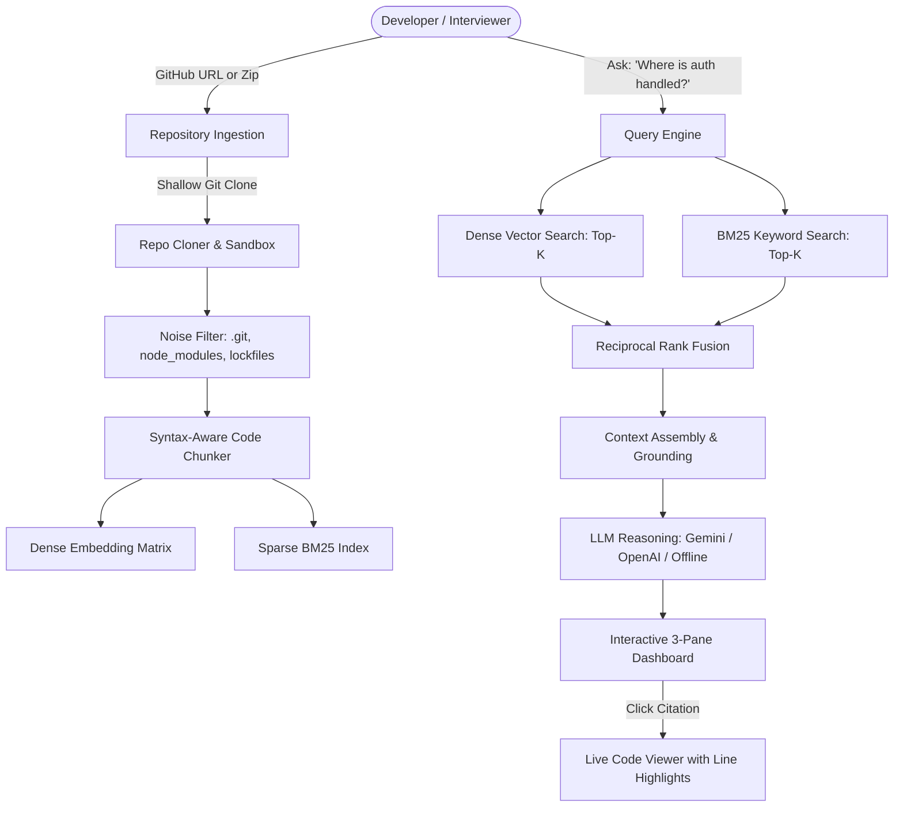

# 🧠 CodeRAG: AI Developer Assistant & Codebase Knowledge Engine

[](https://python.org)
[](https://fastapi.tiangolo.com)
[](#)
[](#)

> **A production-ready Codebase Retrieval-Augmented Generation (RAG) assistant designed for software engineering workflows and SDE technical interviews.**
> Ingest any public GitHub repository or ZIP archive, parse syntax-aware code boundaries, perform hybrid retrieval, and ask deep architectural questions with exact file and line number citations.

---

## 🌟 Key Features & Engineering Innovations

1. **Syntax-Aware Structural Code Chunking**
   - Traditional text RAG naively slices files every 500 characters, severing functions in half and cutting off imports.
   - CodeRAG analyzes language boundaries (Python `def`/`class`, JavaScript/TypeScript functions & export blocks, Go routines, etc.) and tags each chunk with full scope metadata (`file_path`, `start_line`, `end_line`, `scope_type`).

2. **Hybrid Search with Reciprocal Rank Fusion (RRF)**
   - **Dense Semantic Embeddings** capture conceptual meaning (*"Where are user passwords verified?"*).
   - **Sparse BM25 Keyword Search** captures exact code identifiers (*"Where is `DB_PORT_5432` or `jwt_auth_token`?"*).
   - Results are unified using **Reciprocal Rank Fusion** ($RRF(d) = \sum \frac{1}{60 + r(d)}$), avoiding incompatible score scale normalization issues.

3. **Grounded Citations with Live Code Inspector**
   - Prompts enforce strict grounding: the assistant only answers from ingested snippets and provides verified `[file_path:start-end]` citations.
   - The interactive 3-pane UI lets developers click any citation to immediately inspect the source code with glowing line-range highlights.

4. **Multi-Provider LLM & Zero-Key Offline Demo Mode**
   - Out-of-the-box support for **Google Gemini (Free tier)** and **OpenAI**.
   - Includes a deterministic **Offline Heuristic Engine** so interviewers and evaluators can test the entire RAG pipeline without needing paid API keys.

---

## 🏛️ System Architecture



---

## 🚀 Quickstart Guide

### 1. Prerequisites
- Python 3.10+
- Git

### 2. Installation
Clone this repository and create a virtual environment:

```bash
git clone https://github.com/varshitha-byte/Rag_project1.git
cd Rag_project1

# Create and activate virtual environment
python -m venv venv
# On Windows:
venv\Scripts\activate
# On Linux/macOS:
# source venv/bin/activate

# Install dependencies
pip install -r requirements.txt
```

### 3. Launching the Application
Run the all-in-one runner:

```bash
python run.py
```

Open your browser to:
- **Interactive Web Dashboard**: [http://127.0.0.1:8000](http://127.0.0.1:8000)
- **Interactive Swagger API Docs**: [http://127.0.0.1:8000/docs](http://127.0.0.1:8000/docs)

---

## 📚 Interview Preparation & Architecture Docs

- [**Architecture Decision Records (ADR)**](file:///c:/Users/varsh/OneDrive/Desktop/RAG%201/docs/ARCHITECTURE_DECISIONS.md): In-depth breakdown of every library, algorithm, and trade-off choice (FastAPI vs Flask, Hybrid vs Dense, Vector Store vs In-Memory).
- [**Master Interview Cheat Sheet**](file:///c:/Users/varsh/OneDrive/Desktop/RAG%201/docs/INTERVIEW_CHEATSHEET.md): 15+ high-frequency interview questions with word-for-word answers, mental models, and complexity analyses.

---

## 🔌 API Endpoints Reference

| Method | Endpoint | Description |
|---|---|---|
| `POST` | `/api/ingest` | Clones a GitHub repo, chunks code, and generates hybrid index |
| `POST` | `/api/upload-zip` | Uploads a `.zip` codebase archive directly |
| `POST` | `/api/query` | Executes hybrid search and synthesizes grounded answer |
| `GET` | `/api/repos` | Lists all indexed repositories |
| `GET` | `/api/repos/{id}/tree` | Retrieves hierarchical file tree |
| `GET` | `/api/repos/{id}/file` | Fetches file content and metadata for line viewer |
| `GET` | `/api/health` | Health status and version telemetry |

---

## 📄 License
MIT License. Feel free to use and adapt this project for portfolio showcases and technical interviews.
